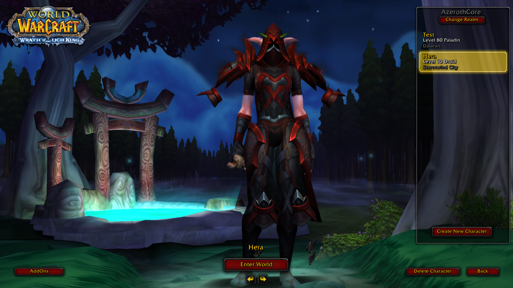

# wxl.equip-plus (x64)

A WarcraftXL mod for the recompiled x64 client that puts 3D models on every armour slot. It is an x64 port of
[TheDaveCalaz/wxl-equip-plus](https://github.com/TheDaveCalaz/wxl-equip-plus) 1.3.0 (upstream commit `ac7440c`)
and, like upstream, is licensed under GPL-3.0.

The original 32-bit extension detoured the client. x64 has no detours, so this port uses a runtime service,
`wxl.m2`, plus component seams added to WarcraftXL core, sdk and client. Those changes are on the `mod-support`
branch of [Tyrallis/client](https://github.com/Tyrallis/client), [Tyrallis/core](https://github.com/Tyrallis/core)
and [Tyrallis/sdk](https://github.com/Tyrallis/sdk).



## What it does

- Two models on every armour slot: ItemDisplayInfo `ModelName_1/2` and `ModelTexture_1/2` on shirt, chest, waist,
  legs, feet, wrists, hands, tabard and cloak, plus the head's `ModelName_2`.
- Icon2 `<attach1>:<attach2>:<flags>:<folder>` and its flags 0x2-0x80.
- Collection pieces (`:geosets`, `Collections` folder) with geoset filtering. They attach to the root and follow
  the body's bones (matched by key bone id, name, then nearest pivot), also on the character panel copy.
- `WXLItemDisplayModels.csv` and `WXLItemDisplayModelMaterials.csv` sidecars.
- Belts on stock bodies, which lack the BeltBuckle point: a stand-in point between the hips.
- Works on players, dressed NPCs, character select and the dressing room.
- Live retail physics (plumes, chains, cloth, wings) for every model with a row in a physics table:
  `DBFilesClient\WXLEquipPlusPhysics.phy2` (the Backport Helper's pieces), and the Retroport
  Workbench's `WXLCreaturePhysics.phy2` (creatures, mounts) and `WXLSpellPhysics.phy2` (spell models).
  Run by Kirazul's port of retail's engine (`src/physics`, see its README) on `wxl.m2`'s bone watchers.
  `[Physics] Enabled=1` in the mod's (or the client's) `WXLExtendedEquipment.ini`.
- An Equip Plus panel in game: **F9** or `/equipplus`. Live physics on/off, its cost, the CSV counts,
  the verbose log, and reloading the CSVs and physics tables.
- Every `data\*.MPQ` in the mod folder is mounted, so a generated payload (for example `patch-W.MPQ`) can ship
  next to the mod.

## Not ported yet

- Head/shoulder takeover (replacing the client's own helm or pauldron models).
- Weapon and creature model CSVs (need a virtual-file provider in `wxl.storage`).
- Animation sync, helm offsets, retarget fit options.
- WarcraftXL's shared F9 overlay (`wxl.ui` is not published on x64): the panel is a game interface frame.

## Build

Needs a checkout of the WarcraftXL SDK (`mod-support` branch) at `../../sdk`, or pass `-DWXL_SDK_DIR=...`.

```
cmake -S . -B build
cmake --build build --config Release
```

Copy `build\dist\wxl.equip-plus\` into `<client>\bin\Win\Mods\`.

## Settings

- `<mod>\WXLExtendedEquipment.ini`, `[Log] Verbose=1` (or env `WXL_EQUIP_LOG=1`): one log line per piece.
- An empty `<mod>\WarcraftXL_equip-plus.disable` file switches the mod off.
